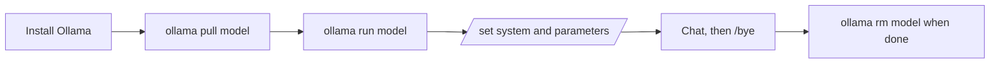

# Ollama Practice: Running LLMs Locally with the CLI

A quick-start guide to running large language models on your own machine with [Ollama](https://ollama.com/), using only the command line. No API keys or cloud services are needed, and everything runs locally.

## What is Ollama?

Ollama is a tool that downloads, manages, and runs open-source LLMs locally. Once a model is pulled, you can chat with it in the terminal, tune its behaviour, and later connect it to your own applications.

## Installation

Download Ollama for your operating system from [ollama.com/download](https://ollama.com/download).

Check that it installed correctly:

```bash
ollama --version
```

## Core commands

| Task | Command |
|------|---------|
| Download a model | `ollama pull <model-name>` |
| List installed models | `ollama ls` or `ollama list` |
| Run a model (interactive chat) | `ollama run <model-name>` |
| Delete a model | `ollama rm <model-name>` |

**Example**

```bash
ollama pull mistral-medium-3.5
ollama ls
ollama run mistral-medium-3.5
```

> Find available models at [ollama.com/search](https://ollama.com/search), and make sure the model fits your machine's memory before pulling it.

## Commands inside a chat session

After `ollama run <model-name>`, you get an interactive prompt. These commands start with `/`:

| Command | What it does |
|---------|--------------|
| `/bye` | Exit the model |
| `/show` | Show details about the current model (type `/show` to see the available options) |
| `/set` | Change settings for the session (type `/set` to see everything you can set for that model) |
| `/set parameter` | Fine-tune model parameters such as temperature |
| `/set system "..."` | Set the system instruction for the session |

### Setting a system instruction

```
>>> /set system "You are a helpful assistant"
```

The model now follows this instruction for the rest of the session. You can check it with:

```
>>> /show system
```

### Tuning parameters

```
>>> /set parameter temperature 0.7
```

Run `/set parameter` on its own to see the parameters available for your model.

## Other useful commands

| Command | What it does |
|---------|--------------|
| `ollama ps` | Show which models are currently loaded in memory |
| `ollama show <model-name>` | Show a model's details, such as size and parameters |
| `ollama stop <model-name>` | Unload a running model from memory |
| `ollama serve` | Start the Ollama server manually |

## Typical workflow



## Where this leads

Ollama also exposes a local server (default `http://localhost:11434`), which lets you use these models from Python and frameworks such as LangChain. For example, see the Ollama embeddings notebook in my [RAG-Concepts](https://github.com/SyedaNaziaGit/RAG-Concepts) work.

## Documentation

- [Ollama documentation](https://docs.ollama.com/)
- [Ollama model library](https://ollama.com/search)


---
# Ollama Practice

My notes on running LLMs locally using the Ollama command line (CLI).

## 1. Install Ollama

Download Ollama from [ollama.com/download](https://ollama.com/download), then check it works:

```bash
ollama --version
```

## 2. Manage models

**Download a model**

```bash
ollama pull model-name
# example
ollama pull mistral-medium-3.5
```

**List installed models**

```bash
ollama ls
# or
ollama list
```

**Delete a model**

```bash
ollama rm model-name
```

## 3. Run a model

```bash
ollama run model-name
# example
ollama run mistral-medium-3.5
```

To exit the model:

```
/bye
```

## 4. Commands inside a session

| Command | Purpose |
|---------|---------|
| `/show` | Shows other available commands and details, similar to help |
| `/set` | Lists every setting you can change for that model |
| `/set parameter` | Fine-tune the model's parameters |
| `/set system "..."` | Set the system instruction |

**Setting a system instruction**

```
/set system "You are a helpful assistant"
```

The message is now the model's system instruction. You can view it again with:

```
/show system
```

## 5. Quick reference

| Task | Command |
|------|---------|
| Check version | `ollama --version` |
| Download a model | `ollama pull model-name` |
| List models | `ollama ls` or `ollama list` |
| Run a model | `ollama run model-name` |
| Exit | `/bye` |
| Delete a model | `ollama rm model-name` |

## Documentation

- [Ollama docs](https://docs.ollama.com/)
